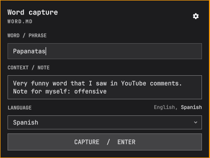

# Word Capture

A bar widget for [Omarchy](https://omarchy.org) that collects vocabulary into
a Markdown file. Click the book icon in the bar, type a word or phrase, add some
context or a note if you like, press Enter. The entry goes under its language's heading,
and a notification confirms it.



## Install

```sh
omarchy plugin add <repository-url> --enable
```

Pick a bar section when asked (it defaults to the right). To place it later:
`omarchy plugin enable alexander.word-capture --section right`.

Everything it needs ships with Omarchy: `sh`, `awk`, `flock`, `wl-paste`
(wl-clipboard), `omarchy-file-select`, `omarchy-launch-editor` and
`omarchy-notification-send`.

## Use

| Action                  | Does                                                        |
|-------------------------|-------------------------------------------------------------|
| Click the bar icon      | Open or close the panel, with the word field focused        |
| Right-click the icon    | Open the words file in your editor (created if missing)     |
| Click the file name     | Same, from the panel header                                 |
| Enter                   | Save, close the panel, show a notification                  |
| Shift+Enter             | New line in the context field (it grows to 5 lines, then scrolls) |
| Esc or click outside    | Close; what you typed is kept for next time                 |
| Click the notification  | Open the words file                                         |
| Gear icon               | Settings                                                    |

**Language.** The language is picked from the alphabet of the word: Latin,
Cyrillic, Greek, Arabic, Hebrew, any letter, or your own set of characters.
When several languages match, the names next to LANGUAGE show them; click one
or use the dropdown to choose, and your choice holds for that word.

**Already captured.** While you type a word that is already in the file, the
word field gets a yellow border and a hint says so. You can still save it.

**Settings.**

- *Markdown file*: the path of your words file (default
  `~/Documents/words.md`). Edit it, or use the folder button to choose a
  folder; the file name stays and is selected so you can rename it. "Created
  on first capture" shows when the file does not exist yet.
- *Prefill from clipboard* (off by default): when the panel opens, put the
  clipboard text into the Word or the Context field, only if that field is
  empty. The cursor then goes to the other field.
- *Languages*: name, alphabet, and order. Use the up and down arrows to
  reorder; the first match in the list is selected by default.

## File format

One line per entry, under a `## <Language>` heading. New entries go to the
end of their section; a missing section is added at the end of the file. Any
other text in the file is left as it is.

```markdown
## Spanish

- **casa** [Spanish] — la casa es grande
- **perro** [Spanish]

## Russian

- **дом** [Russian] — мой дом
```

`*`, `_` and `\` in an entry are escaped so they cannot break the Markdown.
Context with several lines is saved on one line, its lines joined with ` / `.
Saving is atomic and locked, so the file is never left half-written.

## Privacy

Word Capture reads only the file you set and its own settings. With
*Prefill from clipboard* on, it reads the clipboard (`wl-paste`) each time
the panel opens; the text is used only to fill the field and is not stored
unless you save it. Nothing is sent anywhere.

## Uninstall

```sh
omarchy plugin remove alexander.word-capture
rm -f "${XDG_STATE_HOME:-$HOME/.local/state}/omarchy/word-capture.json"
```

The second line removes the settings. Your words file is never touched.

## Details

- **Matching a language.** Only the word's letters count: spaces, digits,
  punctuation (`don't`, `rock-n-roll`), symbols and emoji are skipped, and
  text is Unicode-normalized (NFC) first. A custom set reads like
  `A-Za-zÀ-ÿ`: ranges with `-`, `\` to escape a character or spell one
  (`\u00e9`). It is never run as a regular expression; a broken set matches
  nothing.
- **Duplicates.** Words are compared case-insensitively after normalizing
  Unicode and spaces, so `Casa` equals `casa`.
- **Cost.** Nothing is read before the panel is first opened. After that the
  file is watched and re-read only when it changes (about 2 ms per thousand
  entries).
- **Settings file.** `${XDG_STATE_HOME:-~/.local/state}/omarchy/word-capture.json`.
  Missing or unreadable settings fall back to the defaults.

## Development

- `WordCapture.qml`: the bar button and panel, built from the shell's own
  components.
- `Model.js`: language detection, entry format, duplicate index, clipboard
  cleanup.
- `append.sh`: writes one entry into its section (temp file, atomic rename,
  `flock`).
- Tests: `sh tests/run.sh` (needs `node`).
- After editing the QML, run `omarchy restart shell`.

## License

MIT, see [LICENSE](LICENSE).
